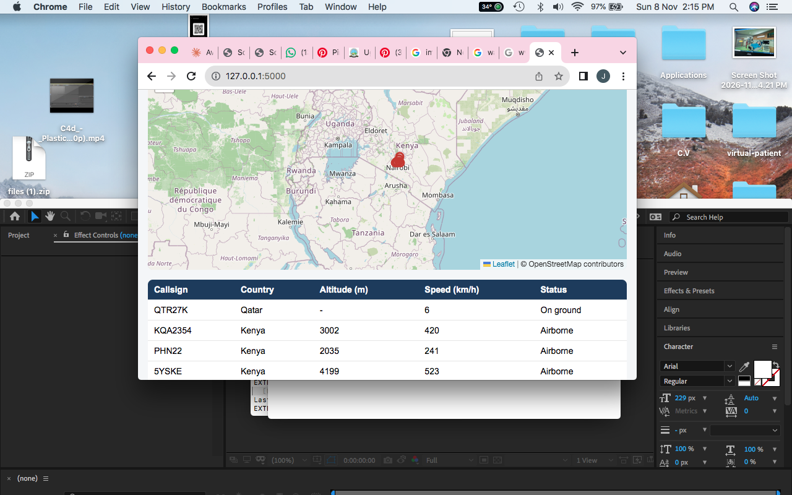

# School Records

A small web app for an aviation training school, built with Python, Flask and SQLite.

## Features
- Student records with fees, payments and balances
- Dashboard with totals and outstanding fees
- Printable payment receipts
- WhatsApp reminder button for students who owe fees
- Licence and medical expiry tracker (red, orange, yellow, green status)
- Password login and one-click database backup
- CSV export for Excel

## Run it
    python3 -m pip install flask
    python3 app.py
Open http://127.0.0.1:5002 (demo password: demo1234)

## Notes
This is a demo with fake data. Login is a single shared password and the app
runs locally, so it is not ready for real student data on the internet.
Next steps would be user roles, aircraft maintenance dates and a flight-hours logbook.

## Author
OPAR JOSHUA | Diploma in IT (Business), UICT | joshuaopar7@gmail.com
